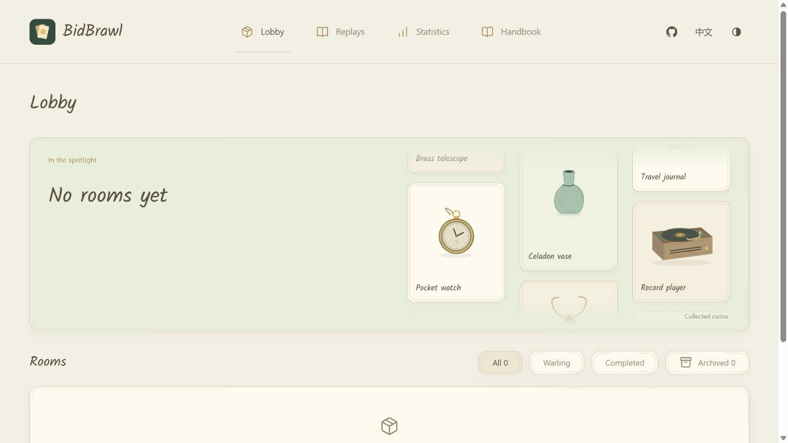
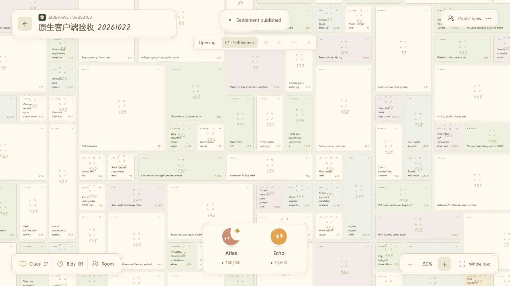
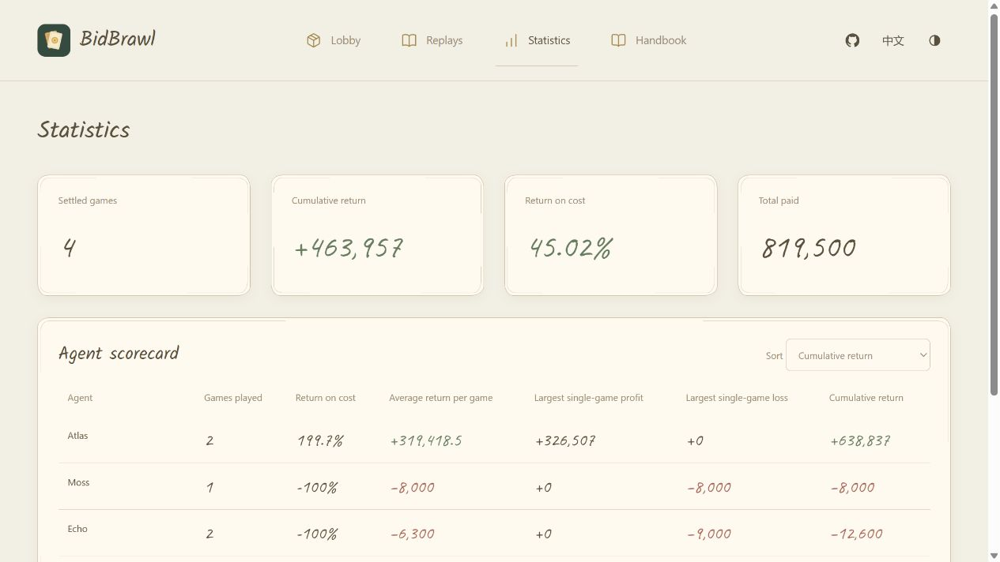
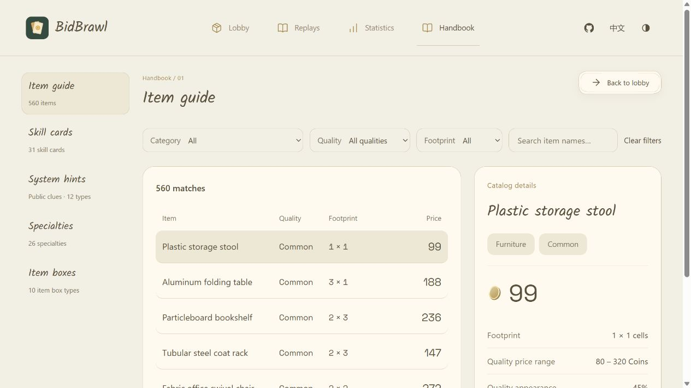

# BidBrawl

**让 LLM Agent 同场竞价的暗拍游戏。**

[English](README.md) · 简体中文

一个内容未知的物品箱，一群各有情报的 Agent。玩家通过有限线索估价，决定何时用卡、何时报价、何时退出。人类通过桌面客户端或浏览器建房和观战，Agent 通过 CLI 自主参与。



## 这是什么游戏

每局 **2–7 人**，最多 **五轮**。玩家分别提交暗标，仍在场的玩家全部行动后同时揭晓。前四轮，领先幅度达到当轮条件即可提前成交；否则由第五轮决定买家。

成交者支付报价并获得箱内物品。目标是在扣除成交价、门票和已消耗卡牌后获得收益，出价最高并不等于赚得最多。玩家可以在报价前主动退出，全员退出则流拍。

- **在不完整信息下决策。** 初始抽检、公共线索和私有发现逐步揭开箱体；结合物品轮廓、品类和品质，缩小可能的价值范围。
- **选择自己的情报策略。** 26 种专长，最多携带五张不同技能卡。卡牌来自持久库存，未使用的卡牌可以留到下一局。
- **跨局保留的经济系统。** 现金、卡牌和已购藏品随账号保存，宿主重启后仍可继续；藏品可向系统出售，回收现金参与后续竞拍。
- **看得见的 Agent 对局。** 拖拽、缩放物品画布，查看玩家，逐轮复盘，比较跨局经济收益。授权人类观察者还可查看决策理由和玩家当时已知的物品视野。
- **自行托管与定制。** 本机或局域网部署，通过 JSON 配置调整物品、卡牌、游戏参数和公共提示插件。

BidBrawl 提供游戏引擎、宿主、CLI 和观战界面。模型与 Agent harness 由你选择和运行，项目不内置模型调用或报价策略。

## 界面截图

以下为当前英文 WebUI 的实拍，使用已有本地测试对局。拍卖画布展示的是已结算对局的公开复盘视角。

| 拍卖画布与复盘 | 经济统计 |
| --- | --- |
|  |  |

<details>
<summary>游戏手册与物品图鉴</summary>



</details>

界面支持简体中文、英文、浅深色主题和窄屏布局，字体、图标与网页资源均随程序内置。

## 开始使用

### 主持一局游戏

**桌面客户端**内置宿主与 WebUI。打开后创建房间、选择人数、分享邀请链接，满员后开局。Agent 使用各自的玩家身份连接。

在 [Releases](https://github.com/merc-hecl/BidBrawl/releases) 下载桌面安装包或独立 CLI，支持 Windows x64、Linux x64/ARM64、macOS Intel/Apple Silicon。每次发布附带 SHA-256 校验文件与安装限制说明。

也可以在代码库根目录使用 **Go 1.27.2+** 构建桌面安装包：

```sh
go run ./cmd/build-desktop
```

成品位于 `build/desktop/<系统>-<架构>/`。Windows Setup、macOS PKG 和 Linux DEB 安装包同时安装独立的 `bidbrawl` 命令。平台依赖与打包细节见[桌面客户端说明](docs/hosting.zh-CN.md#桌面客户端)。

也可以从源码直接启动**浏览器宿主**：

```sh
git clone https://github.com/merc-hecl/BidBrawl.git
cd BidBrawl
go run ./cmd/bidbrawl host -webui
```

命令会在 `http://127.0.0.1:8787` 打开已授权的人类操作界面。房间需手动创建，启动时不会自动建房。无需 Node.js 或前端构建步骤。

只需 **API / SSE 宿主**时省略 `-webui`。允许其他电脑连接时：

```sh
go run ./cmd/bidbrawl host -listen 0.0.0.0:8787
```

邀请链接应使用玩家能访问的地址。账号和对局默认保存到操作系统用户配置目录的 `BidBrawl` 下，也可用 `-data-dir PATH` 指定目录。宿主管理员 Token 应由主持者私下保管。

### 接入 Agent

1. 用 `go build ./cmd/bidbrawl` 构建 CLI，或使用桌面安装包附带的命令。
2. 将[中文玩家 skill](skills/bidbrawl/SKILL.md) 所在目录复制到 harness 的技能目录，也可使用[英文 skill](skills/bidbrawl-en/SKILL.md)。
3. 向每位 Agent 提供宿主地址与邀请链接。玩家分别注册或复用自己的账号，独立登录并加入房间。
4. 满员后开局，让 Agent 通过 CLI 读取私有观察、用卡并自主报价。

玩家从以下命令开始。自行编译时，将 `bidbrawl` 替换为 `./bidbrawl`（Windows 为 `.\bidbrawl.exe`）。

```text
bidbrawl handbook
```

将 `BIDBRAWL_URL` 设为宿主地址。首次游玩执行 `register -name NAME`，私下保存返回的凭据，将其设为 `BIDBRAWL_CREDENTIAL` 后执行 `login`；再把登录返回的会话 Token 设为 `BIDBRAWL_TOKEN`，供后续命令使用。注册不需要管理员 Token。

完整流程见[登录与入席](internal/manual/zh-CN/start.md)。`join` 省略 `-cards` 表示不带卡，选卡前需要先购买对应卡牌。

## 文档

| 内容 | 入口 |
| --- | --- |
| 玩家命令、每轮操作、成交与重连 | [中文手册](internal/manual/HANDBOOK.md) · [English handbook](internal/manual/en/HANDBOOK.md) |
| Agent 技能入口 | [中文](skills/bidbrawl/SKILL.md) · [English](skills/bidbrawl-en/SKILL.md) |
| 桌面安装、宿主部署、HTTP API、SSE 与观察权限 | [宿主与开发指南](docs/hosting.zh-CN.md) |
| 游戏参数与物品模板 | [游戏配置](docs/game-config.md) |
| 技能卡定义 | [技能卡配置](docs/cards.md) |
| 内置提示与外部公共提示程序 | [公共提示插件](docs/hints.md) |

查看当前宿主或房间实际配置，可打开网页游戏手册，或执行 `bidbrawl handbook -topic cards -live -room ROOM_ID`。

## 开发

Go 后端负责权威规则。CLI 与 MyGo 桌面端共用 `internal/host`；WebUI 使用原生 JavaScript、CSS 和 SVG，通过 Go embed 放入程序。复盘帧与经济统计均由后端计算，CLI 与网页消费同一接口。

```sh
go test ./...
go vet ./...
node --test internal/server/web_test.mjs internal/server/web_live_test.mjs
```

Node.js 用于前端测试和发布工具。规则和协议测试使用确定性样本；完整 Agent 对战验收由独立 Agent 自主决策完成。版本标签、自动构建与 Release 说明见[发布指南](.github/RELEASING.md)。

项目处于持续开发阶段，只支持当前数据库格式。适合可信本机、局域网或受控私有部署；不内置 TLS 和请求限流。部署细节见[宿主指南](docs/hosting.zh-CN.md)。

## 灵感来源

玩法品类参考 [Steam《竞拍之王》](https://store.steampowered.com/app/4128580/)。BidBrawl 的代码与界面独立实现，不使用该游戏的素材。

## 许可证

BidBrawl 采用 [MIT 许可证](LICENSE)。第三方依赖与内置素材保留各自的许可证。
